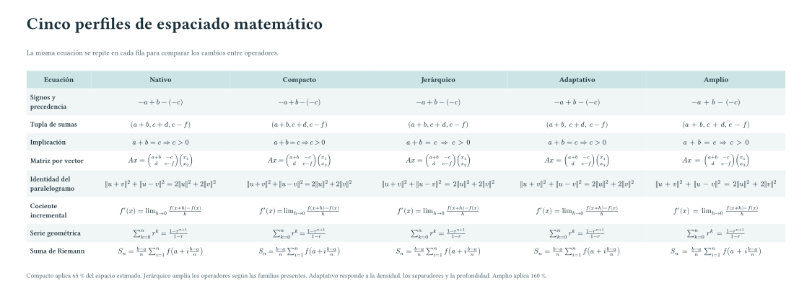

# Better math spacing · 0.1.0

Ajusta la distancia entre átomos de una ecuación mediante reglas de Typst. La fórmula se escribe una sola vez. La regla de presentación conserva la ecuación original para etiquetas, numeración y referencias. Versión local probada con Typst 0.15.1, sin dependencias de ejecución.

```typst
#import "lib.typ": group, rule, spacing

#show math.equation: spacing.with(groups: (
  signos: group(sym.plus, sym.minus, before: 4mm, after: 4mm),
))
$a + b - c$
```



La galería utiliza el punto de entrada real. Contiene las configuraciones completas para la puntuación, los encuentros entre operadores, el factor global condicionado por dos grandes operadores y las jerarquías relativas a los grupos presentes. [Ejemplos compilables](examples/gallery.typ)

## API

| Función | Uso |
| --- | --- |
| `group(..members, before: none, after: none, test: none)` | Agrupa símbolos (`sym.plus`), clases (`"large"`) y funciones de elemento (`math.frac`). Basta que coincida un miembro. El predicado opcional se aplica además de esa coincidencia. Con cero miembros selecciona cualquier átomo que satisfaga el predicado. |
| `rule(value, left: none, right: none, when: none)` | Aplica un valor a una frontera. Los filtros por nombre de grupo izquierdo, derecho y predicado se combinan con «y». |
| `spacing(eq, groups: (:), rules: ())` | Se instala con `#show math.equation: spacing.with(...)`. Las claves del diccionario nombran los grupos. `rules` acepta una lista o una función que recibe la ecuación analizada y devuelve una lista. |

**Un valor por frontera.** Cada grupo puede solicitar una longitud anterior y otra posterior en pt, mm, em o combinaciones de esas unidades. Dentro de un átomo prevalece el último grupo que declare ese lado. En la frontera se toma la petición anterior del átomo derecho y, si falta, la posterior del izquierdo. En ausencia de ambas se parte de `auto`. Las reglas se aplican después en orden de declaración.

**Transformaciones.** Una longitud sustituye la distancia y `auto` devuelve la decisión a Typst. Un porcentaje multiplica la distancia acumulada o, si sigue en `auto`, la estimación del perfil nativo. Por ejemplo, `rule(150%)` amplía un 50 % el espaciado conocido y deja las fronteras desconocidas en `auto`. Un porcentaje en `rule` es un factor. Los márgenes de `group` requieren longitudes. Una función puede devolver cualquiera de estos valores.

```typst
#import "lib.typ": group, rule, spacing

#let grupos = (
  binario: group(test: a => a.role == "binary"),
  unario: group(test: a => a.role == "unary"),
)
#show math.equation: spacing.with(groups: grupos, rules: (
  rule(0.3em, left: "binario"),
  rule(e => e.width + 1pt, left: "binario", right: "unario"),
))
$a + -b$
```

**Jerarquía contextual.** Este ejemplo mantiene la implicación aislada con su espacio nativo. Si aparece una igualdad en la misma subexpresión, duplica el espacio de la implicación. El cálculo utiliza el perfil del motor para el estilo matemático de esa frontera.

```typst
#import "lib.typ": group, rule, spacing

#show math.equation: spacing.with(
  groups: (igualdad: group(sym.eq), implica: group(sym.arrow.r.double)),
  rules: (rule(200%, when: e =>
    "implica" in (e.left.groups + e.right.groups)
      and e.run.any(a => "igualdad" in a.groups)),),
)
$a => b$  $a = b => c$
```

**Contexto de los predicados.**

- `group(test: a => ...)` recibe el contenido original en `a.node`, la clase en `a.class` y el rol resuelto en `a.role` (`"unary"`, `"binary"` o `none`). Un adjunto hereda la clase de su base y conserva su tipo de elemento. Los miembros de tipo símbolo seleccionan glifos directos.
- `when` y la función de transformación reciben `e.left` y `e.right` con sus listas de nombres `groups`. `e.left-class` y `e.right-class` son las clases enfrentadas. `e.left-after` y `e.right-before` contienen las peticiones originales o `none`. `e.width` es el valor acumulado y `e.native` es la estimación del espaciado automático o `auto`.
- `e.index` indica la posición del átomo izquierdo en `e.run`, comenzando en cero. `e.path` contiene pasos desde la raíz con `parent`, `field` y, según el paso, `index`, `row` o `col`. Una celda, un índice y cada rama de una fracción tienen ámbitos independientes. Los espacios explícitos separan las listas de vecinos.
- `e.equation.node` es la ecuación original. `e.equation.runs` contiene las listas de átomos accesibles. La variante `rules: eq => ...` recibe esa misma vista una vez por ecuación. La galería la usa para detectar un patrón en un lugar y aplicar su factor en toda la expresión.

## Alcance y límites

- El perfil reproduce las reglas de clases de Typst 0.15.1, usa sus constantes `math.thin`, `math.med` y `math.thick`, y tiene en cuenta el tamaño de índices, celdas y fracciones. Es una estimación previa al renderizado. Cuando interviene el espaciado textual de una cerca y la distancia depende de la fuente, el perfil devuelve `auto`. [Algoritmo del compilador](https://github.com/typst/typst/blob/v0.15.1/crates/typst-library/src/math/ir/process.rs#L256-L295)
- La implementación recorre símbolos, enteros, operadores de texto simples, clases explícitas, delimitadores, raíces, fracciones, matrices, vectores y adjuntos con sus índices y primas. Una estructura opaca, como una caja, un envoltorio de estilo, texto libre, un salto o un punto de alineación, delega **la ecuación completa** a Typst. Así un selector local tampoco alcanza por accidente una copia del contenido dentro de la parte opaca.
- Typst selecciona secuencias por valor. Si numerador y denominador son idénticos, ambos pueden recibir el mismo plan. Pedir distancias distintas para esas dos ramas produce un diagnóstico con sus rutas. Los contenedores se conservan, incluidos los paréntesis que Typst recuerda internamente para fracciones horizontales.
- Se determina el papel del signo antes de insertar un espacio a su izquierda. Un glifo variable que era binario recibe `math.class("binary", ...)` cuando hace falta conservar ese papel. En un operador variable compuesto que requeriría forzar la clase del conjunto, se delega la frontera. Una regla externa que cambie después la clase, el tamaño matemático o el contenido puede discrepar del análisis. Los estilos externos, las sustituciones independientes y las referencias tienen cobertura de regresión.

## Compilar y verificar

Desde la raíz del repositorio, con Typst 0.15.1 y Python 3:

```sh
typst compile --root . examples/gallery.typ galeria.pdf
python3 tests/check.py
```

Para importar desde un documento en este repositorio, usa la ruta relativa a `lib.typ`. En un directorio local de paquetes con la estructura `local/better-math-spacing/0.1.0`, la importación es `#import "@local/better-math-spacing:0.1.0": group, rule, spacing`. El paquete está preparado para uso local. [Manifiesto](typst.toml)

Las pruebas comparan geometría, posiciones de `mspace`, árboles MathML, roles, referencias y reglas de estilo. Las sondas originales siguen ejecutándose como controles independientes. [Diseño e investigación iniciales](docs/diseno.md) · [Pruebas del paquete](tests/package.typ)

El código se distribuye bajo [licencia MIT](LICENSE). La tabla de clases incluye los [avisos de los datos de origen](NOTICE).
