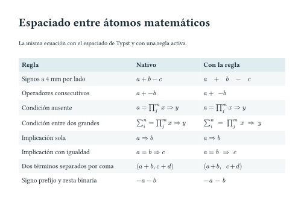

# Better math spacing

Investigación para un paquete de espaciado matemático en Typst. **Los seis casos de uso se reproducen en Typst 0.15.1 con ecuaciones escritas en su sintaxis habitual.** Una regla local puede sustituir la separación entre átomos y conservar la ecuación que Typst utiliza para numerar, referenciar y consultar.

El repositorio contiene sondas ejecutables, una comparación visual y una propuesta de API. La implementación del paquete y su publicación en Universe quedan para la siguiente fase. [Diseño y ejemplos de la API propuesta](docs/diseno.md)



## Qué se comprobó

| Pregunta | Resultado reproducible |
| --- | --- |
| ¿Cuánto espacio se sustituye? | A 12 pt con New Computer Modern Math, `a+b` mide 26,333 pt. Con ambas separaciones a cero mide 21 pt. Con 4 mm a cada lado mide 43,677 pt, exactamente 8 mm más que con cero. Se miden avances, incluidos los márgenes propios de cada glifo. |
| ¿Pueden cambiarse los lados por separado? | Sí. Anteponer un `h` a un signo de clase `vary` borra el precedente que Typst usa para decidir su rol. Para el `+` binario de la muestra, conservar ese rol mantiene tanto el margen derecho nativo como la forma infija en MathML. |
| ¿Sirven las unidades relativas? | Cada `1em` mide 12 pt en el cuerpo y 8,4 pt en el subíndice de la muestra. El motor matemático descarta `h(10%)` y `h(1fr)` en las pruebas. |
| ¿Puede una condición afectar a toda la fórmula? | En `sum_i^n = product_j^m (a+b)`, la igualdad entre dos grandes operadores activa el mismo factor en dos niveles. Duplicar los cuatro espacios de relación y binario aumenta el ancho exactamente 12 pt. El control que empieza por `a` conserva sus distancias. |
| ¿Se conserva la estructura? | En la muestra con fracción, matriz, sumatorio y ambos índices, los árboles MathML coinciden al descontar las distancias. Los controles detectan la pérdida del rol binario. También se verifican etiquetas únicas, referencias, contadores, `alt` en la ecuación, estilo externo y una sustitución de símbolo. |

Tres límites afectan al contrato del paquete.

- **Espacio nativo.** Typst calcula internamente la separación y la clase efectiva. Una regla puede conservar esa decisión o sustituirla. Para multiplicarla debe disponer de una base numérica conocida. La prueba del factor dos emplea un perfil contrastado con el resultado nativo. [Procesamiento matemático en Typst 0.15.1](https://github.com/typst/typst/blob/v0.15.1/crates/typst-library/src/math/ir/process.rs#L126-L295)
- **Identidad de las subexpresiones.** En estilo horizontal, `$(a+b)/(c-d)$` y `$frac(a+b,c-d)$` exponen campos iguales, pero la primera conserva paréntesis de origen. Reconstruirla desde esos campos los pierde. Al conservar su contenedor y modificar las secuencias interiores, los paréntesis sobreviven. Si ambas ramas de una fracción son idénticas, un selector por valor alcanza a ambas. [Sonda de fracciones y colisiones](probes/scopes.typ)
- **Otras reglas.** Los estilos externos y una sustitución independiente siguen funcionando en las pruebas. Una regla ajena que convierte `+` en relación durante el renderizado puede alterar la clase después de nuestra inspección. Forzar el papel binario en ese caso modifica el margen derecho en 0,667 pt a 12 pt. [Sonda de geometría y reclasificación](probes/geometry.typ)

## Reproducir

Se utilizó `typst 0.15.1 (9dfd3a08)` con las fuentes incorporadas y Python 3 con su biblioteca estándar. Desde la raíz de este repositorio:

```sh
python3 tests/check.py
typst eval --ignore-system-fonts --in probes/geometry.typ 'query(metadata).first().value'
typst compile --ignore-system-fonts probes/gallery.typ docs/comparacion.svg
```

El comprobador compila las sondas, verifica las aserciones geométricas y compara los árboles MathML, incluyendo el orden de operandos, los índices y el atributo `form` de los operadores. Examina el SVG para los colores. El exportador HTML de esta versión requiere `--features html`, que el comprobador activa. Los resultados HTML son pruebas sobre la salida del compilador. [Implementación de las comprobaciones](tests/check.py)

## Antecedentes

- **Equate** usa reglas sobre ecuaciones existentes para adaptar su numeración y sus filas. Su tratamiento de contadores y etiquetas motivó la prueba de identidad con `query` y referencias. [Código de Equate](https://github.com/typst/packages/blob/main/packages/preview/equate/0.3.3/src/equate.typ)
- **Physica** inspecciona adjuntos para reconocer notaciones como la transpuesta. Es un precedente para leer campos específicos de un elemento matemático. [Código de Physica](https://github.com/typst/packages/blob/main/packages/preview/physica/0.9.8/physica.typ)
- **Unichar** permite consultar la clase matemática Unicode de un carácter. Typst introduce ajustes propios, por ejemplo para `:` y `.`, y resuelve clases de compuestos y operadores variables durante el renderizado. Una tabla Unicode aislada sería insuficiente para explicar las medidas. [Unichar](https://typst.app/universe/package/unichar/) · [Clasificación del compilador](https://github.com/typst/typst/blob/v0.15.1/crates/typst-utils/src/lib.rs#L357-L395)

## Publicación futura

`better-math-spacing` es el nombre del repositorio de investigación. Al preparar la primera versión habrá que elegir el nombre público conforme a las reglas de Universe, fijar la autoría y la licencia, y crear `typst.toml` con un punto de entrada importable y la versión mínima comprobada. Los ejemplos de la documentación de distribución deberán compilar contra ese punto de entrada. Las sondas y el SVG podrán excluirse del archivo que descarguen los usuarios. [Guía oficial de publicación](https://github.com/typst/packages/blob/main/docs/README.md) · [Manifiesto](https://github.com/typst/packages/blob/main/docs/manifest.md)
