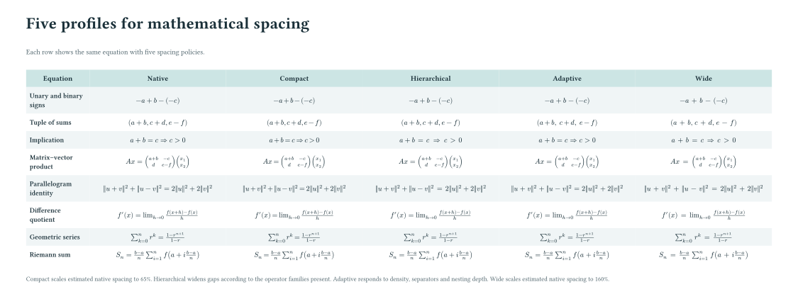
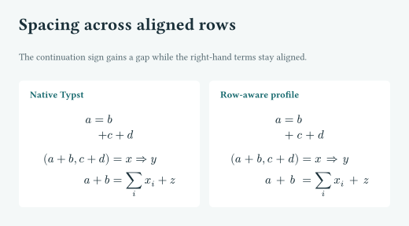

# Better math spacing

**Experimental 0.1.1 · Typst 0.15.1**

Adjust spacing between math atoms with a Typst show rule. You write the equation once and specify which boundaries to adjust. The original equation retains its numbering, labels and references. The package has no runtime dependencies.

## Install locally

Use a checkout of the [GitHub repository](https://github.com/Eisiem/better-math-spacing) with Typst 0.15.1. On Linux or macOS, run the installer with Python 3 available:

```sh
git clone https://github.com/Eisiem/better-math-spacing.git
cd better-math-spacing
./scripts/link-local.sh
```

The script links the checkout into `local/better-math-spacing/0.1.1` under Typst's package directory. It uses `TYPST_PACKAGE_PATH` when set. Otherwise, it uses `${XDG_DATA_HOME:-$HOME/.local/share}/typst/packages` on Linux or `~/Library/Application Support/typst/packages` on macOS. The script prints the link path and can be run again for the same checkout. [Typst's local package documentation](https://github.com/typst/packages#local-packages)

Run `typst info` to locate a custom package directory. Pass that directory as the script's only argument, or set `TYPST_PACKAGE_PATH` for both the installer and the compiler. To install manually, place a symlink to the checkout at `<package-directory>/local/better-math-spacing/0.1.1`. On Windows, a directory junction also works. Keep the checkout at its linked location. To uninstall, remove the link.

## Quick start

In any project compiled with your local Typst CLI:

```typst
#import "@local/better-math-spacing:0.1.1": group, spacing

#show math.equation: spacing.with(groups: (
  signs: group(sym.plus, sym.minus, before: 4mm, after: 4mm),
))

$a + b - c$
```

## Gallery



Compact and wide scale estimated native spacing. Hierarchical draws attention to higher-ranking operators when other operator groups are present. Adaptive responds to density, separators and nesting depth. [Gallery source](examples/gallery.typ) · [Profile configurations](examples/profiles.typ)

## API reference

| Function | Behavior |
| --- | --- |
| `group(..members, before: none, after: none, test: none)` | Matches any listed symbol, math class name or element function. An optional `test(atom)` must also accept the atom. With an empty member list, the predicate alone determines membership. |
| `rule(value, left: none, right: none, when: none)` | Adjusts one boundary. When supplied, `left` and `right` name required groups on the respective sides. The optional `when(edge)` adds a condition. |
| `spacing(eq, groups: (:), rules: (), rows: none, continuation: none)` | Applies the configuration to a math equation. Bind the named arguments with `spacing.with(...)` in a show rule. `groups` maps names to groups. `rules` is an array or a function that accepts the equation view and returns an array. |

With the default `rows: none`, callbacks receive the original 0.1.1 records. Use `rows: "context"` to inspect an entire row while adjusting only existing editable boundaries. Use `rows: "aligned"` to also adjust eligible gaps across an alignment point.

Group predicates classify individual atoms before the row is assembled. Put a margin that depends on other atoms in a boundary rule, where the completed row and its group memberships are available.

A group can set each side independently using lengths in pt, mm, em or a combination. On each atom, the last matching group that supplies a length for that side wins. At a boundary, the right atom's `before` takes precedence over the left atom's `after`. If neither is supplied, the starting value is `auto`.

Rules run in declaration order. A length replaces the current value. `auto` returns the boundary to native spacing. A ratio such as `150%` scales the current length, or scales the native estimate when the current value is `auto` and an estimate exists. A callback can return any of these values.

| Callback | Fields |
| --- | --- |
| Group predicate | `node` is the original content, `index` is its position in the flattened sequence, `class` is the math class, and `role` is `"unary"`, `"binary"` or `none`. A selected continuation adds a `spacing-role` override. Use `a.at("spacing-role", default: a.role)` for the effective typographic role. Attachments inherit the class of their base. Symbol members match direct glyphs. |
| Boundary predicate or value callback | `left` and `right` include the atom fields plus `groups`, `before`, `after`, and facing classes `l` and `r`. `left-class` and `right-class` name the opposing classes. `left-after` and `right-before` expose the group requests. `width` is the current value and `native` is the native estimate or `auto`. |
| Boundary position | `run` contains the contiguous atoms and `index` is the zero-based position of the left atom within it. `path` leads from the equation body to the sequence. Each step supplies `parent` and `field`, with `index`, `row` or `col` where applicable. |
| Row context (opt-in) | `row.index` counts explicit row breaks from zero in the current sequence. Typst can suppress a break inside a table cell. `row.atoms` contains its accessible direct atoms in source order, across alignment points, explicit spaces and opaque barriers. A nested sequence (e.g. a denominator or matrix cell) has its own rows and `path`. A compound counts as one atom in its parent. |
| Aligned boundary (row modes) | `aligned` is true for an eligible operator–term pair across one `&` when `rows: "aligned"`. Here `run` is the **left** editable run, `index` its last position, and `right` the first atom of the next run. For ordinary boundaries, `right == run.at(index + 1)`. |
| Equation callback | The equation view exposes the original `node` and accessible `runs`. The same view is available as `edge.equation` in boundary callbacks. Use this view to decide once per equation which rules to apply. |

## Examples

These examples use the same local import as above, with `rule` added to the import list.

### Set an exception for two adjacent operators

Give binary operators a trailing margin of 0.3 em, then add 1 pt when the next operator is unary.

```typst
#let groups = (
  binary: group(test: a => a.role == "binary"),
  unary: group(test: a => a.role == "unary"),
)
#show math.equation: spacing.with(groups: groups, rules: (
  rule(0.3em, left: "binary"),
  rule(e => e.width + 1pt, left: "binary", right: "unary"),
))
$a + -b$
```

### Widen implications when an equality is present

The rule doubles the margins of `=>` when an equality occurs in the same run.

```typst
#show math.equation: spacing.with(
  groups: (equality: group(sym.eq), implies: group(sym.arrow.r.double)),
  rules: (rule(200%, when: e =>
    "implies" in (e.left.groups + e.right.groups)
      and e.run.any(a => "equality" in a.groups)),),
)
$a => b$  $a = b => c$
```

### Space a continuation sign and rank operators by row

```typst
#show math.equation: spacing.with(
  rows: "aligned",
  continuation: sign => sign.row-index == 1 and sign.node == $+$.body,
  groups: (binary: group(sym.plus, after: 4pt, test: a => a.at("spacing-role", default: a.role) == "binary"),),
)

$ a = &b \ + &c + d $
```

The predicate sees a direct variable-class sign at the start of a continuation row, immediately followed by an eligible `&` and a term. It receives `node`, `index`, `class`, native `role`, and `row-index`. Returning `true` requests binary spacing for this occurrence. With no group width, its crossed boundary starts at Typst's medium binary spacing. Group widths and subsequent rules override it as usual. `rule(auto)` restores the native gap. The original sign, its native `role` and `edge.native` retain their meaning. Without the predicate, a leading `+` keeps its unary spacing unless a rule explicitly changes the gap.



The example profile ranks arithmetic and set operations, relations, logical connectives, and implications in that order. It counts only the groups present in `edge.row.atoms`, starting at zero. Each gap is `minimum × multiplier^level`. A matrix, sum or product in that scope raises every level once. The profile leaves punctuation and unary signs to Typst. [Configurable profile](examples/row-profile.typ) · [Before and after](examples/aligned-rows.typ)

## Known limitations

- The native profile estimates spacing from Typst's math classes and script styles. It uses `auto` for some font-dependent boundaries. [Typst 0.15.1 spacing algorithm](https://github.com/typst/typst/blob/v0.15.1/crates/typst-library/src/math/ir/process.rs#L256-L295)
- Explicit spacing, text, opaque content, row breaks and alignment points divide editable runs. With `rows: "aligned"`, the package can replace a gap before the first, third or subsequent odd-numbered marker in a top-level, multiline display equation. The left atom must be a direct glyph of class `vary`, `binary`, `unary`, `relation` or `large`. The right atom must be a simple letter, ordinary glyph or number. Whitespace in the source is harmless. Explicit gaps on either side, consecutive markers (`&&`), even markers, inline and single-row equations retain their native cross-marker spacing. An opaque expansion or nested fence with hidden layout markers can also disable crossing. Within-run edits still apply. Opaque roots and some nested compounds are delegated to Typst. The package also leaves boundaries native when adding a gap could change an operator's role.
- For PDF, SVG and PNG, the gap goes in the preceding right-aligned cell. The terms in the next column still share their alignment coordinate. A wider cell can change the width or page position of the entire alignment. HTML/MathML keeps the native crossed gap because adding a space in the cell can change the exported `mo` form. Row-aware rules still apply within each cell. [Typst’s alignment and spacing policy](https://github.com/typst/typst/blob/v0.15.1/crates/typst-library/src/math/ir/process.rs#L119-L125)
- Typst 0.15.1 exposes identical glyph content for `xor` and `plus.o` (⊕). A profile can give that glyph a shared interpretation or leave its spacing native. The example leaves it native.
- Equal sequences in the same selector scope must receive the same plan. Two identical branches of one fraction produce a diagnostic if they request different plans. Separate siblings have independent scopes.
- External show rules can change a class, size or content after the package analyzes an equation. Combine spacing transformations in a single `rules` array to control their order.

## Development

Run the regression suite with Typst 0.15.1 and Python 3:

```sh
python3 tests/check.py
mkdir -p build
typst compile --root . --ignore-system-fonts examples/gallery.typ build/gallery.pdf
```

The suite covers rendered geometry, MathML, equation references, style interactions and scope collisions. The technical reports include the original measurements. [Design notes](docs/design.md) · [Original audit](docs/audit.md) · [Comparative audit](docs/review.md) · [Row compatibility and timings](docs/row-audit.md) · [Changelog](CHANGELOG.md)

The package is MIT-licensed. [License](LICENSE) · [Third-party data notices](NOTICE)
